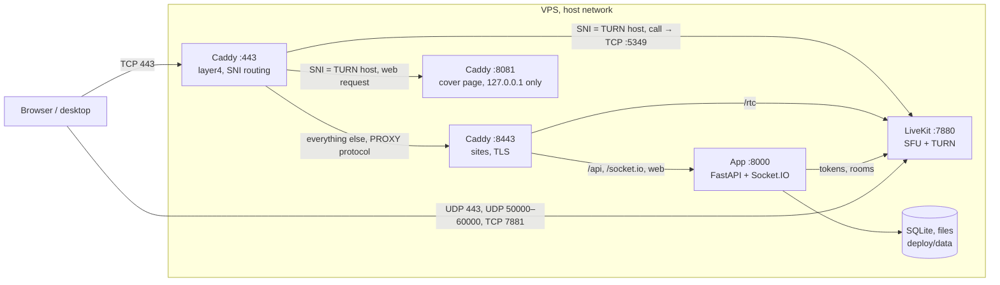

# Gomex

**English** · [Русский](README.ru.md)

Private chat and calls for friends on one cheap VPS.

Gomex is a closed Discord for a small group: text and voice channels, DMs and group chats, video, screen share,
files, reactions, mentions. One server, one group, invite-only sign-up. Calls hold up on difficult networks: when a
direct connection fails, LiveKit falls back to TURN on port 443 (TLS over TCP, or UDP). The whole stack takes about
120 MB of memory: one Python app with SQLite, LiveKit and Caddy. The interface is in English and Russian.

## Contents

- [Security](#security)
- [Architecture](#architecture)
- [Installation](#installation)
  - [Your own server from the app](#your-own-server-from-the-app)
  - [Install by command](#install-by-command)
  - [Local development](#local-development)
- [Usage](#usage)
- [Settings](#settings)
- [Network and ports](#network-and-ports)
- [Server maintenance](#server-maintenance)
- [Releases](#releases)
- [Maintenance](#maintenance)
- [Contributing](#contributing)
- [License](#license)

## Security

- **Invite-only sign-up.** The `INVITE_CODE` works once, for the first account on an empty server. After that
  everyone has a personal invite link with a limited number of sign-ups.
- **Secrets are generated on the server** and kept in `deploy/.env` with mode 600. They are not in the repository.
  The production image refuses to start with the dev values of `APP_SECRET`, `LIVEKIT_API_SECRET`, `INVITE_CODE`.
- **The app container** runs as uid 10001 with a read-only filesystem (except `/data` and `/tmp`), no Linux
  capabilities, and a 1 GB memory limit.
- **The server:** ufw allows only the required ports (see [Network and ports](#network-and-ports)), SSH is
  rate-limited. The installer switches password login off only when `authorized_keys` already holds a key, so the
  owner can't be locked out.
- **Supply chain:** the installer verifies the SHA-256 of the release archive and of the gum binary, and pulls images
  by digest. Desktop updates are signed with Ed25519 and come from the project's GitHub Releases, whichever server is
  selected.

Report vulnerabilities to the maintainer privately, not in public discussions.

## Architecture



- `DOMAIN` is the cover page, `app.DOMAIN` the app, `<turn>.DOMAIN` the call relay with a neutral name (`media`,
  `cdn`, `static`…) that the installer picks at random.
- Constraints kept: SQLite, one Python process, no new services. Search is FTS5 in SQLite, files live on disk.

| Path | What's there |
|---|---|
| [`server/`](server) | Backend. `app.py` assembles the app, code in the `gomex/` package: a module per domain (`users`, `channels`, `dms`, `uploads`, `realtime`), settings in `config.py`, schema in `db.py` |
| [`web/`](web) | Client: React 19, Vite, HeroUI v3, Tailwind 4, LiveKit. `src/` is split by domain: `account`, `chat`, `voice`, `people`, `shell`, `ui`, `store` |
| [`desktop/`](desktop) | Electron shell: lives in the tray so calls arrive with the window closed, global push-to-talk, signed updates |
| [`deploy/`](deploy) | Compose, Caddyfile, installer, release and backup scripts |
| [`.github/workflows/images.yml`](.github/workflows/images.yml) | Builds the `gomex-app` and `gomex-caddy` images (amd64 and arm64) on a `v*` tag |

## Installation

### Your own server from the app

The main path: the app for Mac or Windows ([download](https://github.com/gomex-inc/gomex/releases/tag/desktop)),
no terminal and no domain of one's own needed.

1. **VPS server.** Ubuntu or Debian (x86_64 or arm64), 1–2 GB RAM, 3 GB disk, root access. The IP and password come
   from the hosting company.
2. **"Your own server" in the app.** IP and root password. Address: a free `name.dedyn.io` on
   [deSEC](https://desec.io) (name and email, confirmed by letter) or an own domain with three A records.
3. **Install.** About five minutes, steps shown on screen. The app runs the same installer over SSH, then opens the
   server setup: name, icon, administrator, invite link.

Password login is switched off after the install, and the app keeps its own key (in the system keychain). If the
deSEC letter doesn't arrive within 15 minutes, the app offers another email or an own domain.

### Install by command

For an own domain, and for anyone installing from a terminal. Needed:

- A VPS on Ubuntu or Debian (x86_64 or arm64), root access. Memory from 1 GB (2 is better), 3 GB or more free disk,
  ports 80 and 443 free.
- A domain with three A records pointing at the server IP: the domain itself, `app.` and a subdomain for calls. The
  installer picks its name and shows a table. On Cloudflare: grey cloud, DNS only; calls don't pass through the proxy.

On the server:

```bash
curl -fsSL https://github.com/gomex-inc/gomex/releases/latest/download/install.sh | sh
```

If GitHub is unavailable, the same release is on npm as the `@gomex.llc/install` package (no Node needed on the
server):

```bash
curl -fsSL https://cdn.jsdelivr.net/npm/@gomex.llc/install@latest/install.sh | sh
```

The installer fetches the release archive from there too when GitHub doesn't answer, and checks the same SHA-256.

The wizard checks the server, asks for the domain, shows a summary and sets everything up: Docker (get.docker.com),
ufw, SSH key login, `.env` with secrets, nightly backups, the release images. At the end: the link
`https://app.DOMAIN/?setup=CODE`. Arrows and Enter choose, Esc goes a step back. Without a terminal or without gum the
same steps run as plain questions.

Without questions, for scripts:

```bash
curl -fsSL https://github.com/gomex-inc/gomex/releases/latest/download/install.sh | DOMAIN=chat.example.com GOMEX_YES=1 sh
```

Update: run it again, or without questions:

```bash
curl -fsSL https://github.com/gomex-inc/gomex/releases/latest/download/install.sh | sh -s update
```

The first-setup link (with the install code) once more, while the setup isn't finished:

```bash
curl -fsSL https://github.com/gomex-inc/gomex/releases/latest/download/install.sh | sh -s link
```

Restore data from a nightly copy (a channel deleted by mistake, or a broken server; on a new server, first put the
copies into `/root/gomex-backups/daily`):

```bash
curl -fsSL https://github.com/gomex-inc/gomex/releases/latest/download/install.sh | sh -s restore
```

The installer lists the copies with date and size, asks which one to restore (`GOMEX_YES=1 GOMEX_RESTORE=2026-10-18`
skips the question), saves the current data as a `pre-restore-<time>` copy in the same folder, stops the app, puts the
data back, starts it and checks that it answers. A wrong choice is undone by the same `restore` with the
`pre-restore-…` copy.

A deleted channel doesn't need this: it sits for a week in "Server → Deleted channels", and an admin restores it
from there.

Remove Gomex from the server:

```bash
curl -fsSL https://github.com/gomex-inc/gomex/releases/latest/download/install.sh | sh -s uninstall
```

The installer asks for confirmation (`GOMEX_YES=1` skips it), stops the containers and removes their images, the
`/opt/gomex` folder (`.env`, chats, files), the backups in `/root/gomex-backups`, the nightly timer, its own file and
log in `/root` and `/var/log`. SSH login goes back to what it was: the `00-gomex-key-only.conf` file and the app's key
(the line commented `gomex-app`) are removed. Docker and ufw stay. What's removed can't be restored, backups included.

`.env` and the data are left alone on update. Extra installer variables are described in the header of
[`deploy/install.sh`](deploy/install.sh): `SERVER_NAME`, `TURN_HOST`, `GOMEX_DIR` (default `/opt/gomex`),
`GOMEX_NO_GUM=1`, `GOMEX_FIREWALL=0`, `GOMEX_SSH=0`, an own release archive or image registry.

The cover page on the domain itself is rewritten by the installer on every update. An own site goes into
`/opt/gomex/landing/site` together with an empty `.custom` file: then the installer leaves it alone. Pages open without
`.html`: `/about` is `about.html`.

Own Caddy blocks go in `*.caddy` files in `/opt/gomex/deploy/sites`; updates leave them alone. For example,
`www.caddy` to redirect from `www.` (needs a `www` A record):

```caddy
www.{$DOMAIN}, http://www.{$DOMAIN} {
	redir https://{$DOMAIN}{uri} permanent
}
```

After editing, without dropping calls:
`cd /opt/gomex/deploy && docker compose exec caddy caddy reload --config /etc/caddy/Caddyfile --adapter caddyfile`.

### Local development

Needs Python 3.13, Node 22 and [LiveKit](https://docs.livekit.io/home/self-hosting/local/). Three processes in three
terminals.

LiveKit in dev mode: its keys `devkey` / `secret` match the server's default settings.

```bash
brew install livekit
livekit-server --dev
```

The server on port 8010 (Vite proxies to it), data in `server/data`:

```bash
cd server
python3.13 -m venv .venv
.venv/bin/pip install -r requirements.txt
.venv/bin/uvicorn app:app --port 8010 --reload
```

The client on http://localhost:5190, with `/api` and `/socket.io` going to the server:

```bash
cd web
npm ci
npm run dev
```

On an empty database the first-run wizard opens. The default code is `friends`.

Desktop against the local client. `npm run dev` points at the old port 5180, so the address is set explicitly:

```bash
cd desktop
npm ci
GOMEX_URL=http://localhost:5190 npx electron .
```

`GOMEX_LANG=ru` or `GOMEX_LANG=en` forces the desktop language; by default it follows the system's.

Checks before a commit:

```bash
(cd web && npm run build)   # tsc and build
(cd desktop && npm run check:i18n)   # English and Russian have the same keys
deploy/release.sh lint      # bash -n and shellcheck on all scripts in deploy/
```

## Usage

1. Open the `https://app.DOMAIN/?setup=CODE` link from the installer output. The wizard in the browser asks for the
   server name, creates the administrator and checks that calls get through.
2. Invite friends: everyone has a personal invite link that can register 5 people (`INVITE_LIMIT`), and the invitee
   becomes a friend right away. Administrators have no limit.
3. The desktop app for Mac (Apple Silicon and Intel) and Windows: the "Download app" button in the app, or the
   [desktop](https://github.com/gomex-inc/gomex/releases/tag/desktop) release. On first start it asks for the server
   address: paste `app.DOMAIN`. It can be changed later from the tray, "Server address…".

There is no public API: HTTP and Socket.IO are the client's internal protocol, with no versioning and no
compatibility promises.

## Settings

Everything is in `deploy/.env`. The installer writes it; after a manual edit, `docker compose up -d` in `deploy/`.

| Variable | Default | What it does |
|---|---|---|
| `DOMAIN` | — | Root domain; the app is on `app.DOMAIN` |
| `SERVER_NAME` | `Gomex` | Server name until it's set in the browser |
| `TURN_HOST` | random | Subdomain of the call relay |
| `INVITE_CODE` | random | Code for the first account on an empty server |
| `APP_SECRET`, `LIVEKIT_API_KEY`, `LIVEKIT_API_SECRET` | random | Session signing and LiveKit keys; `livekit.yaml` is built from them |
| `ADMINS` | empty | Nicknames that become administrators while the server has none |
| `INVITE_LIMIT` | `5` | How many people one personal link can register |
| `UPLOAD_MB_PER_DAY` | `500` | How many megabytes of files one person can upload per day |
| `RELAY_ONLY` | off | `1`: all calls only through TURN on 443, no direct or UDP paths |
| `GOMEX_REGISTRY`, `GOMEX_VERSION`, `GOMEX_APP_DIGEST`, `GOMEX_CADDY_DIGEST` | from the release | Which images to run; written by the installer |

Don't edit `livekit.yaml` by hand: every install and update rewrites it from
[`deploy/livekit.yaml.tmpl`](deploy/livekit.yaml.tmpl).

## Network and ports

| Port | Outside | Listener | Purpose |
|---|---|---|---|
| 22/tcp | yes, rate-limited | sshd | Access, key only |
| 80/tcp | yes | Caddy | Certificate issuing, redirect to HTTPS |
| 443/tcp | yes | Caddy layer4 | Sites and TURN over TLS, SNI routing |
| 443/udp | yes | LiveKit | TURN over UDP (HTTP/3 is off for it) |
| 7881/tcp | yes | LiveKit | Media over TCP |
| 50000–60000/udp | yes | LiveKit | Direct media |
| 8443/tcp | no | Caddy | Sites behind layer4, with PROXY protocol |
| 8000/tcp | no, 127.0.0.1 | app | API, Socket.IO, web client |
| 7880/tcp | no, 127.0.0.1 | LiveKit | Signaling, reached from outside through `/rtc` |
| 5349/tcp | no | LiveKit | TURN TLS, where layer4 sends it after TLS |
| 8081/tcp | no, 127.0.0.1 | Caddy | Cover page for the relay's name: layer4 sends its web requests here after TLS |

## Server maintenance

The install lives in `/opt/gomex`. Everything below runs from `deploy/`.

```bash
cd /opt/gomex/deploy
docker compose ps                  # what's running
docker compose logs -f app         # app logs; likewise livekit, caddy
journalctl -u gomex-backup         # nightly backup log
```

- **Data:** `data/` (the `hangout.db` database, avatars, uploads), secrets in `.env`, certificates in `caddy-data/`.
- **Backups:** a systemd timer at 04:30 server time, copies in `/root/gomex-backups/daily`, kept 14 days. Images are
  hard-linked between days, so 14 copies take about the space of one. With under 1 GB free on disk the backup is
  skipped and says so in the log.

## Releases

Maintainer only, from a Mac, from a committed tree.

**Server.** Tag, images, archive and the installer pinned to them:

```bash
deploy/release.sh 1.2.3
```

The script sets the tag `v1.2.3` and pushes it. GitHub Actions builds and publishes the images to
`ghcr.io/<owner>`. The script waits for the build, takes the image digests, builds the archive with `git archive`,
writes the version, SHA-256 and digests into `deploy/install.sh`, publishes the archive and installer as the GitHub
Release `v1.2.3` (SHA-256 and digests in the release notes), checks them by their public links and commits
`install.sh`. Install and update take `releases/latest/download/install.sh`, which takes the archive of its own
release. A version with a suffix (`1.2.3-rc.1`) goes out as a pre-release and doesn't move `latest`.
The script publishes the same two files to npm as `@gomex.llc/install@1.2.3`, a mirror for when GitHub is
unavailable. npm must be logged in (`npm login`) and asks for a two-factor code on publishing.
`GOMEX_SKIP_NPM=1` releases without the mirror.
After the very first release, the `gomex-app` and `gomex-caddy` packages on GitHub must be made public once,
otherwise servers can't pull them. The script stops and gives the links.

**Desktop.** Raise `version` in `desktop/package.json`, then:

```bash
deploy/release-desktop.sh            # Mac (Apple Silicon and Intel) and Windows
```

Builds go to this repository's GitHub Releases: `desktop-v1.2.3` holds the version's files, `desktop` always holds
the latest version under permanent names plus `update.json`, which installed apps check. Both are pre-releases;
`latest` stays with the server release. The "Download app" button on any server leads to `desktop`.

Builds are signed with the key `~/.gomex/seed-update-signing-key.pem`, created on the first run. It must be backed up
at once: without it, installed apps stop updating. The public half, `desktop/update-key.pem`, is committed and pushed
before the release. The build has no server address; the app asks for it on first start. `GOMEX_DEFAULT_URL=https://…`
builds one in.

## Maintenance

[@gomex-inc](https://github.com/gomex-inc).

## Contributing

External pull requests aren't accepted yet; when they are, a contributor agreement (CLA) will be needed so the rights
to all the code stay with the maintainer. Questions go to the maintainer directly.

House rules:

- No new services: SQLite, one Python process, LiveKit, Caddy. A new feature builds on what's there.
- Code comments are short, in English, and explain why. Interface text is short, in English and Russian (the desktop's
  strings are in `desktop/i18n.js`), with no explanations.
- The model for behavior is [Fluxer](https://github.com/fluxerapp/fluxer): we look at what's done, but don't copy or
  retell their code (AGPL).
- Before a commit: `npm run build` in `web/` and `deploy/release.sh lint`.

## License

[GNU AGPL-3.0](LICENSE), this version only (`AGPL-3.0-only`). Gomex can be installed, changed and distributed, for
money too. If a modified Gomex is available to people over a network, its source must be opened to them on the same
terms.
