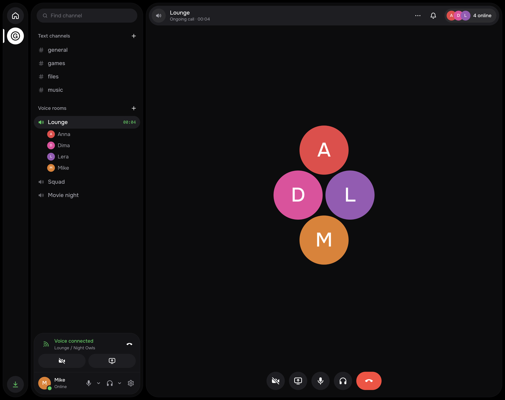
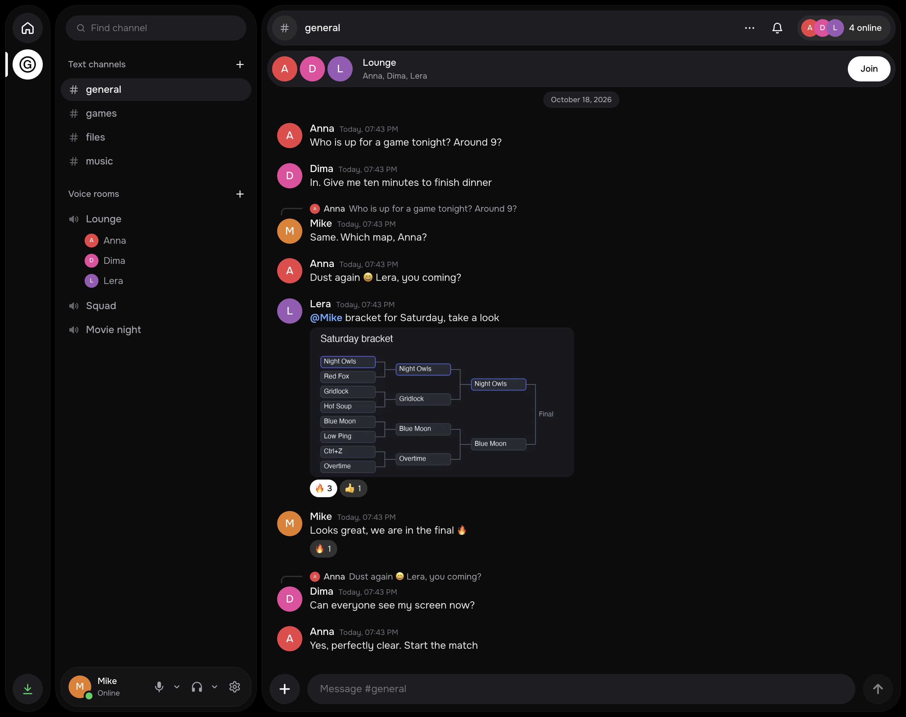
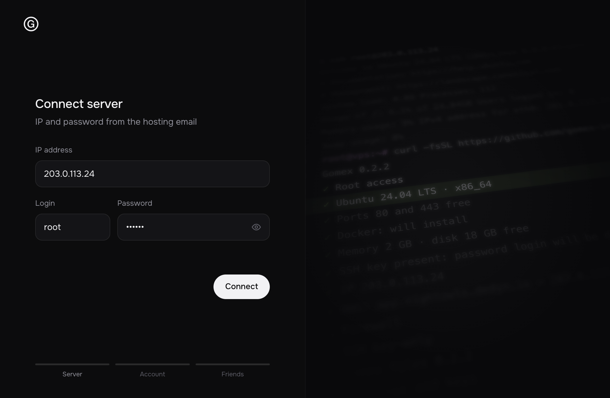
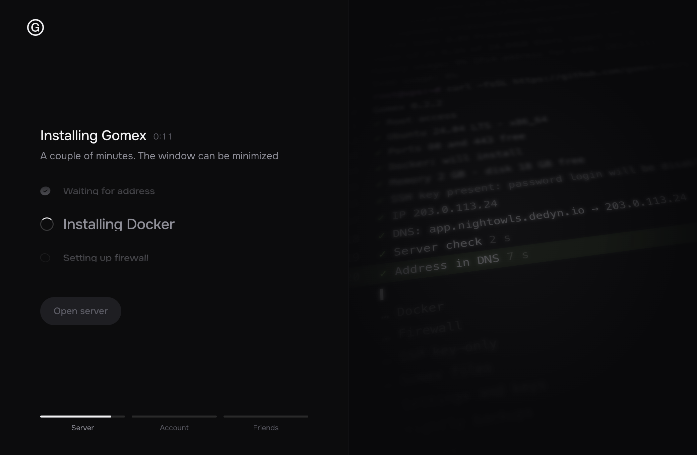
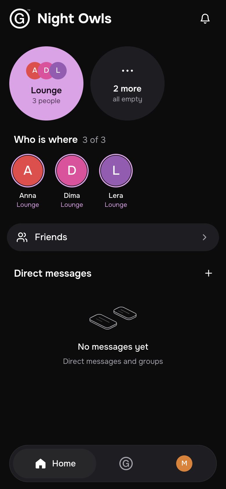
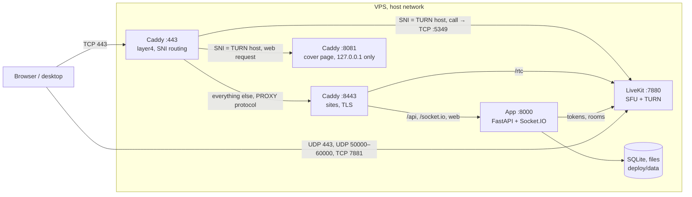

<h1 align="center">Gomex</h1>

<p align="center"><b>Private chat and calls for friends, on your own server.</b><br>Voice rooms, screen share, push-to-talk. One cheap VPS, one command, about 120 MB of memory.</p>

<p align="center"><a href="LICENSE"></a> <a href="https://github.com/gomex-inc/gomex/releases/latest"></a></p>

<p align="center"><b>English</b> · <a href="README.ru.md">Русский</a> · <a href="https://github.com/gomex-inc/gomex/releases/tag/desktop">Download the app</a> · <a href="docs/install.md">Install guide</a></p>

<p align="center"></p>

Gomex is a closed Discord for a small group: text and voice channels, DMs and group chats, video, screen share,
files, reactions, mentions. One server, one group, invite-only sign-up. Calls hold up on difficult networks: when a
direct connection fails, LiveKit falls back to TURN on port 443 (TLS over TCP, or UDP). The whole stack takes about
120 MB of memory: one Python app with SQLite, LiveKit and Caddy. The interface is in English and Russian.

## Quick start

One command on a fresh Ubuntu or Debian VPS (root access, 1 GB of memory is enough):

```bash
curl -fsSL https://github.com/gomex-inc/gomex/releases/latest/download/install.sh | sh
```

The wizard asks for a domain, sets everything up and prints a link to create the administrator. Friends join by
personal invite link.

No terminal, no domain of your own? Use the [desktop app](docs/install.md#your-own-server-from-the-app): it needs only the server's
IP and root password.

## Features

- Text channels, direct messages and group chats; replies, mentions, reactions, files by drag and drop.
- Voice rooms, camera and screen share. A room shows who is in it; joining takes one click.
- Push-to-talk on any key or mouse button, also while the window is minimized.
- Noise suppression with three levels: off, the browser's own, and strong (RNNoise, a small neural network that runs
  in the client).
- Calls fall back to TURN on port 443 when UDP is blocked; the Anti-lag mode sends calls through the server for
  weak connections.
- Invite-only sign-up with personal links; a newcomer becomes a friend of the person who invited them.
- Nightly backups kept for 14 days, one-command restore.
- Desktop apps for Mac and Windows with a tray icon and signed auto-updates; the web client works on phones and can
  be added to the home screen.
- Interface in English and Russian.

## Screenshots

<p align="center">
  <br>
  <sub>Text channels: replies, mentions, reactions, files</sub>
</p>

<table>
  <tr>
    <td width="50%"><br><sub>The desktop app: “Your own server”</sub></td>
    <td width="50%"><br><sub>Installation, step by step</sub></td>
  </tr>
</table>

<p align="center">
  <br>
  <sub>The phone layout in a browser</sub>
</p>

## Architecture



- `DOMAIN` is the cover page, `app.DOMAIN` the app, `<turn>.DOMAIN` the call relay with a neutral name (`media`,
  `cdn`, `static`…) that the installer picks at random.
- Constraints kept: SQLite, one Python process, no new services. Files live on disk.

| Path | What's there |
|---|---|
| [`server/`](server) | Backend. `app.py` assembles the app, code in the `gomex/` package: a module per domain (`users`, `channels`, `dms`, `uploads`, `realtime`), settings in `config.py`, schema in `db.py` |
| [`web/`](web) | Client: React 19, Vite, HeroUI v3, Tailwind 4, LiveKit. `src/` is split by domain: `account`, `chat`, `voice`, `people`, `shell`, `ui`, `store` |
| [`desktop/`](desktop) | Electron shell: lives in the tray so calls arrive with the window closed, global push-to-talk, signed updates |
| [`deploy/`](deploy) | Compose, Caddyfile, installer, release and backup scripts |
| [`.github/workflows/images.yml`](.github/workflows/images.yml) | Builds the `gomex-app` and `gomex-caddy` images (amd64 and arm64) on a `v*` tag |

## Security

- **Invite-only sign-up.** The `INVITE_CODE` works once, for the first account on an empty server. After that
  everyone has a personal invite link with a limited number of sign-ups.
- **Secrets are generated on the server** and kept in `deploy/.env` with mode 600. They are not in the repository.
  The production image refuses to start with the dev values of `APP_SECRET`, `LIVEKIT_API_SECRET`, `INVITE_CODE`.
- **The app container** runs as uid 10001 with a read-only filesystem (except `/data` and `/tmp`), no Linux
  capabilities, and a 1 GB memory limit.
- **The server:** ufw allows only the required ports (see [Network and ports](docs/operations.md#network-and-ports)), SSH is
  rate-limited. The installer switches password login off only when `authorized_keys` already holds a key, so the
  owner can't be locked out.
- **Supply chain:** the installer verifies the SHA-256 of the release archive and of the gum binary, and pulls images
  by digest. Desktop updates are signed with Ed25519 and come from the project's GitHub Releases, whichever server is
  selected.

Report vulnerabilities to the maintainer privately, not in public discussions.

## Documentation

- [Installation](docs/install.md): from the app or by command, update, restore, remove, installer options.
- [Operation](docs/operations.md): first run and invites, settings, ports, maintenance and backups.
- [Development](docs/development.md): local setup, checks, releases.

## Maintenance

[@gomex-inc](https://github.com/gomex-inc).

## Contributing

External pull requests aren't accepted yet; when they are, a contributor agreement (CLA) will be needed so the rights
to all the code stay with the maintainer. Questions go to the maintainer directly.

House rules:

- No new services: SQLite, one Python process, LiveKit, Caddy. A new feature builds on what's there.
- Code comments are short, in English, and explain why. Interface text is short, in English and Russian (the desktop's
  strings are in `desktop/i18n.js`), with no explanations.
- The model for behavior is [Fluxer](https://github.com/fluxerapp/fluxer): we look at what's done, but don't copy or
  retell their code (AGPL).
- Before a commit: `npm run build` in `web/` and `deploy/release.sh lint`.

## License

[GNU AGPL-3.0](LICENSE), this version only (`AGPL-3.0-only`). Gomex can be installed, changed and distributed, for
money too. If a modified Gomex is available to people over a network, its source must be opened to them on the same
terms.
