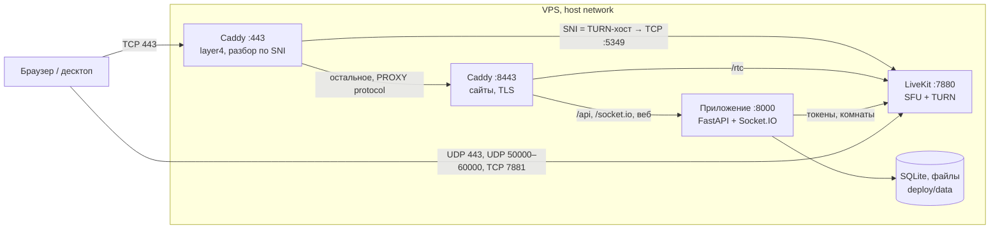

# Gomex

Приватный чат и звонки для своих на одном дешёвом VPS.

Gomex — закрытый Discord для небольшой компании: текстовые и голосовые каналы, личка и группы, видео,
демонстрация экрана, файлы, реакции, упоминания. Один сервер — одна компания, вход только по приглашению.
Звонки держатся и в капризных сетях: если прямое соединение не проходит, LiveKit переключается на TURN через
порт 443 (TLS поверх TCP или UDP). Весь стек — около 120 МБ памяти: одно приложение на Python
с SQLite, LiveKit и Caddy.

## Содержание

- [Безопасность](#безопасность)
- [Устройство](#устройство)
- [Установка](#установка)
  - [Свой сервер одной командой](#свой-сервер-одной-командой)
  - [Локальная разработка](#локальная-разработка)
- [Использование](#использование)
- [Настройки](#настройки)
- [Сеть и порты](#сеть-и-порты)
- [Обслуживание сервера](#обслуживание-сервера)
- [Релизы](#релизы)
- [Сопровождение](#сопровождение)
- [Участие](#участие)
- [Лицензия](#лицензия)

## Безопасность

- **Вход только по приглашению.** Код из `INVITE_CODE` годится один раз, для первого аккаунта на пустом
  сервере. Дальше у каждого своя ссылка-приглашение на ограниченное число регистраций.
- **Секреты генерируются на сервере** и лежат в `deploy/.env` с правами 600. В репозитории их нет.
  Продакшн-образ отказывается стартовать с dev-значениями `APP_SECRET`, `LIVEKIT_API_SECRET`, `INVITE_CODE`.
- **Контейнер приложения** работает от uid 10001, файловая система только для чтения (кроме `/data` и `/tmp`),
  без Linux-capabilities, с лимитом памяти 1 ГБ.
- **Сервер:** ufw пропускает только нужные порты (см. [Сеть и порты](#сеть-и-порты)), SSH ограничен по частоте.
  Вход по паролю установщик выключает, только если в `authorized_keys` уже есть ключ, чтобы не запереть владельца.
- **Цепочка поставки:** установщик сверяет SHA-256 релизного архива и бинарника gum, а образы тянет по digest.
  Обновления десктопа подписаны Ed25519 и приходят из GitHub Releases проекта, какой бы сервер ни был выбран.

Уязвимость сообщайте сопровождающему лично, не в публичных обсуждениях.

## Устройство



- `DOMAIN` — обложка, `app.DOMAIN` — приложение, `<turn>.DOMAIN` — ретранслятор звонков
  с нейтральным именем (`media`, `cdn`, `static`…), которое установщик выбирает случайно.
- Ограничения, которые держим: SQLite, один процесс Python, никаких новых сервисов. Поиск — FTS5 в SQLite,
  файлы — на диске.

| Путь | Что там |
|---|---|
| [`server/`](server) | Бэкенд. `app.py` собирает приложение, код в пакете `gomex/`: модуль на домен (`users`, `channels`, `dms`, `uploads`, `realtime`), настройки в `config.py`, схема в `db.py` |
| [`web/`](web) | Клиент: React 19, Vite, HeroUI v3, Tailwind 4, LiveKit. `src/` разложен по доменам: `account`, `chat`, `voice`, `people`, `shell`, `ui`, `store` |
| [`desktop/`](desktop) | Electron-оболочка: живёт в трее, чтобы звонки доходили при закрытом окне, глобальный push-to-talk, подписанные обновления |
| [`deploy/`](deploy) | Compose, Caddyfile, установщик, скрипты релиза и бэкапа |
| [`.github/workflows/images.yml`](.github/workflows/images.yml) | Сборка образов `gomex-app` и `gomex-caddy` (amd64 и arm64) на тег `v*` |

## Установка

### Свой сервер одной командой

Понадобятся:

- VPS на Ubuntu или Debian (x86_64 или arm64), доступ root. Память от 1 ГБ (лучше 2), на диске от 3 ГБ свободно,
  порты 80 и 443 свободны.
- Домен с тремя A-записями на IP сервера: сам домен, `app.` и поддомен для звонков. Его имя установщик
  выберет сам и покажет таблицей. В Cloudflare — серое облако, только DNS: через прокси звонки не пройдут.

На сервере:

```bash
curl -fsSL https://github.com/gomex-inc/gomex/releases/latest/download/install.sh | sh
```

Если GitHub недоступен, тот же релиз лежит в npm как пакет `@gomex.llc/install` (Node на сервере не нужен):

```bash
curl -fsSL https://cdn.jsdelivr.net/npm/@gomex.llc/install@latest/install.sh | sh
```

Архив релиза установщик тоже скачает оттуда, если GitHub не отвечает, и сверит ту же SHA-256.

Мастер проверит сервер, спросит домен, покажет итог и поставит всё сам: Docker (get.docker.com), ufw,
вход по SSH-ключу, `.env` с секретами, ночные бэкапы, образы релиза. В конце — ссылка
`https://app.ДОМЕН/?setup=КОД`. Стрелки и Enter — выбор, Esc — шаг назад. Без терминала или без gum те же шаги
идут простыми вопросами.

Без вопросов, для скриптов:

```bash
curl -fsSL https://github.com/gomex-inc/gomex/releases/latest/download/install.sh | DOMAIN=chat.example.com GOMEX_YES=1 sh
```

Обновление: повторный запуск, или без вопросов:

```bash
curl -fsSL https://github.com/gomex-inc/gomex/releases/latest/download/install.sh | sh -s update
```

`.env` и данные при обновлении не трогаются. Дополнительные переменные установщика описаны в шапке
[`deploy/install.sh`](deploy/install.sh): `SERVER_NAME`, `TURN_HOST`, `GOMEX_DIR` (по умолчанию `/opt/gomex`),
`GOMEX_NO_GUM=1`, `GOMEX_FIREWALL=0`, `GOMEX_SSH=0`, свой архив релиза или реестр образов.

### Локальная разработка

Нужны Python 3.13, Node 22 и [LiveKit](https://docs.livekit.io/home/self-hosting/local/). Три процесса в трёх
терминалах.

LiveKit в dev-режиме: его ключи `devkey` / `secret` совпадают с настройками сервера по умолчанию.

```bash
brew install livekit
livekit-server --dev
```

Сервер на порту 8010 (туда проксирует Vite), данные в `server/data`:

```bash
cd server
python3.13 -m venv .venv
.venv/bin/pip install -r requirements.txt
.venv/bin/uvicorn app:app --port 8010 --reload
```

Клиент на http://localhost:5190, `/api` и `/socket.io` уходят на сервер:

```bash
cd web
npm ci
npm run dev
```

На пустой базе откроется мастер первого запуска. Код по умолчанию — `friends`.

Десктоп против локального клиента. `package-lock.json` в `desktop/` пока отстаёт от `package.json`, поэтому
`npm install`, а не `npm ci`. Скрипт `npm run dev` смотрит на старый порт 5180, поэтому адрес задаётся явно:

```bash
cd desktop
npm install
GOMEX_URL=http://localhost:5190 npx electron .
```

Проверки перед коммитом:

```bash
(cd web && npm run build)   # tsc и сборка
deploy/release.sh lint      # bash -n и shellcheck на всех скриптах deploy/
```

## Использование

1. Откройте ссылку `https://app.ДОМЕН/?setup=КОД` из вывода установщика. Мастер в браузере спросит имя сервера,
   создаст администратора и проверит, проходят ли звонки.
2. Позовите друзей: у каждого своя ссылка-приглашение, по ней можно зарегистрировать 5 человек
   (`INVITE_LIMIT`), приглашённый сразу попадает в друзья. У администраторов лимита нет.
3. Десктоп для Mac (Apple Silicon и Intel) и Windows — кнопка «Скачать приложение» в приложении или релиз
   [desktop](https://github.com/gomex-inc/gomex/releases/tag/desktop). При первом запуске он спрашивает
   адрес сервера: вставьте `app.ДОМЕН`. Сменить его потом можно из трея, «Адрес сервера…».

Публичного API нет: HTTP и Socket.IO — внутренний протокол клиента, без версий и обещаний совместимости.

## Настройки

Всё в `deploy/.env`. Установщик пишет его сам; после ручной правки — `docker compose up -d` в `deploy/`.

| Переменная | По умолчанию | Что делает |
|---|---|---|
| `DOMAIN` | — | Корневой домен; приложение на `app.DOMAIN` |
| `SERVER_NAME` | `Gomex` | Имя сервера, пока его не задали в браузере |
| `TURN_HOST` | случайное | Поддомен ретранслятора звонков |
| `INVITE_CODE` | случайный | Код для первого аккаунта на пустом сервере |
| `APP_SECRET`, `LIVEKIT_API_KEY`, `LIVEKIT_API_SECRET` | случайные | Подпись сессий и ключи LiveKit; `livekit.yaml` собирается из них |
| `ADMINS` | пусто | Ники, которые станут администраторами, пока на сервере нет ни одного |
| `INVITE_LIMIT` | `5` | Сколько человек можно зарегистрировать по одной личной ссылке |
| `UPLOAD_MB_PER_DAY` | `500` | Сколько мегабайт файлов в день можно загрузить одному человеку |
| `RELAY_ONLY` | выключено | `1` — все звонки только через TURN на 443, без прямых и UDP-путей |
| `GOMEX_REGISTRY`, `GOMEX_VERSION`, `GOMEX_APP_DIGEST`, `GOMEX_CADDY_DIGEST` | из релиза | Какие образы запускать; пишет установщик |

`livekit.yaml` не правьте руками: его перезаписывает каждая установка и обновление из
[`deploy/livekit.yaml.tmpl`](deploy/livekit.yaml.tmpl).

## Сеть и порты

| Порт | Снаружи | Кто слушает | Зачем |
|---|---|---|---|
| 22/tcp | да, с ограничением частоты | sshd | Доступ, только по ключу |
| 80/tcp | да | Caddy | Выпуск сертификатов, редирект на HTTPS |
| 443/tcp | да | Caddy layer4 | Сайты и TURN по TLS, разбор по SNI |
| 443/udp | да | LiveKit | TURN по UDP (HTTP/3 выключен ради него) |
| 7881/tcp | да | LiveKit | Медиа по TCP |
| 50000–60000/udp | да | LiveKit | Медиа напрямую |
| 8443/tcp | нет | Caddy | Сайты за layer4, с PROXY protocol |
| 8000/tcp | нет, 127.0.0.1 | приложение | API, Socket.IO, веб-клиент |
| 7880/tcp | нет, 127.0.0.1 | LiveKit | Сигналинг, наружу через `/rtc` |
| 5349/tcp | нет | LiveKit | TURN TLS, сюда шлёт layer4 после TLS |

## Обслуживание сервера

Установка живёт в `/opt/gomex`. Всё ниже — из `deploy/`.

```bash
cd /opt/gomex/deploy
docker compose ps                  # что запущено
docker compose logs -f app         # логи приложения; так же livekit, caddy
journalctl -u gomex-backup         # журнал ночных бэкапов
```

- **Данные:** `data/` (база `hangout.db`, аватары, загрузки), секреты в `.env`, сертификаты в `caddy-data/`.
- **Бэкапы:** systemd-таймер в 04:30 по времени сервера, копии в `/root/gomex-backups/daily`, хранятся 14 дней.
  Картинки между днями связаны жёсткими ссылками, поэтому 14 копий занимают примерно одну.
  Если на диске меньше 1 ГБ, бэкап пропускается и пишет об этом в журнал.

## Релизы

Только для сопровождающего, с Mac, из закоммиченного дерева.

**Сервер.** Тег, образы, архив и закреплённый на них установщик:

```bash
deploy/release.sh 1.2.3
```

Скрипт ставит тег `v1.2.3` и пушит его. GitHub Actions собирает и публикует образы в `ghcr.io/<владелец>`.
Скрипт ждёт сборку, берёт digest образов, собирает архив через `git archive`, вписывает версию, SHA-256 и digest
в `deploy/install.sh`, публикует архив и установщик как GitHub Release `v1.2.3` (SHA-256 и digest — в описании
релиза), проверяет их по публичным ссылкам и коммитит `install.sh`. Установка и обновление берут
`releases/latest/download/install.sh`, а он — архив своего релиза.
Версия с суффиксом (`1.2.3-rc.1`) выходит пре-релизом и `latest` не двигает.
Те же два файла скрипт публикует в npm как `@gomex.llc/install@1.2.3` — зеркало на случай, когда GitHub недоступен. Для этого
npm должен быть залогинен (`npm login`), при публикации он спросит код двухфакторной защиты.
`GOMEX_SKIP_NPM=1` выпускает релиз без зеркала.
После самого первого релиза пакеты `gomex-app` и `gomex-caddy` в GitHub нужно один раз сделать публичными,
иначе серверы не смогут их скачать. Скрипт остановится и даст ссылки.

**Десктоп.** Поднять `version` в `desktop/package.json`, затем:

```bash
deploy/release-desktop.sh            # Mac (Apple Silicon и Intel) и Windows
```

Сборки выходят в GitHub Releases этого репозитория: `desktop-v1.2.3` — файлы версии, `desktop` — всегда последняя
версия под постоянными именами и `update.json`, который проверяют установленные приложения. Оба — пре-релизы,
`latest` остаётся за серверным релизом. Кнопка «Скачать приложение» на любом сервере ведёт в `desktop`.

Сборки подписываются ключом `~/.gomex/seed-update-signing-key.pem`, он создаётся при первом запуске. Его надо сразу
сохранить в бэкап: без него установленные приложения больше не обновятся. Открытая половина,
`desktop/update-key.pem`, коммитится и пушится до выпуска. Адреса сервера в сборке нет, приложение спрашивает его при
первом запуске; `GOMEX_DEFAULT_URL=https://…` встроит адрес.

## Сопровождение

[@gomex-inc](https://github.com/gomex-inc).

## Участие

Внешние pull request'ы пока не принимаются; когда начнём, понадобится соглашение контрибьютора (CLA), чтобы права
на весь код оставались у сопровождающего. Вопросы — сопровождающему напрямую.

Правила для своих:

- Не добавлять сервисов: SQLite, один процесс Python, LiveKit, Caddy. Новая функция строится на том, что есть.
- Комментарии в коде — короткие, на английском, объясняют «почему». Тексты интерфейса — короткие, на русском,
  без объяснений.
- Образец поведения — [Fluxer](https://github.com/fluxerapp/fluxer): смотрим, что сделано, но их код (AGPL)
  не копируем и не пересказываем.
- Перед коммитом — `npm run build` в `web/` и `deploy/release.sh lint`.

## Лицензия

[GNU AGPL-3.0](LICENSE), только эта версия (`AGPL-3.0-only`). Gomex можно ставить, менять и распространять, в том
числе за деньги. Если изменённый Gomex доступен людям по сети, его исходники нужно открыть им на тех же условиях.
