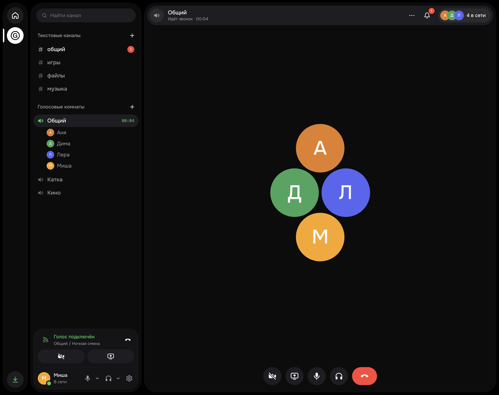
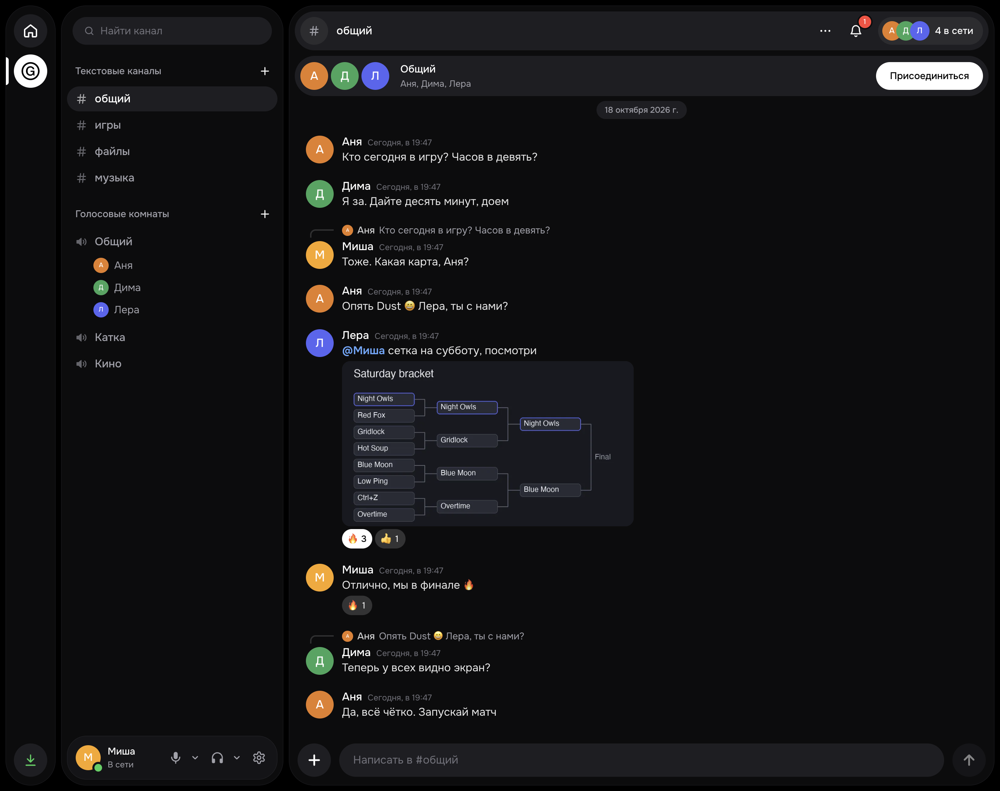
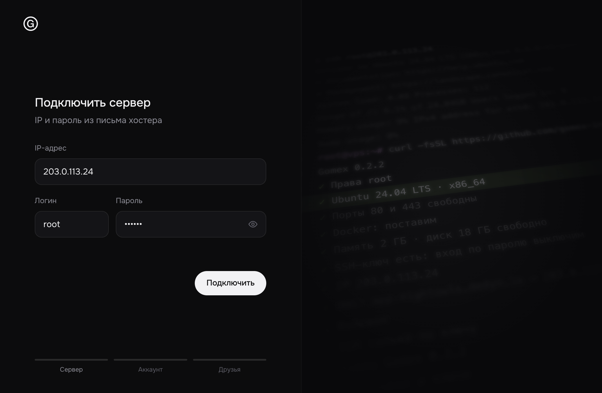
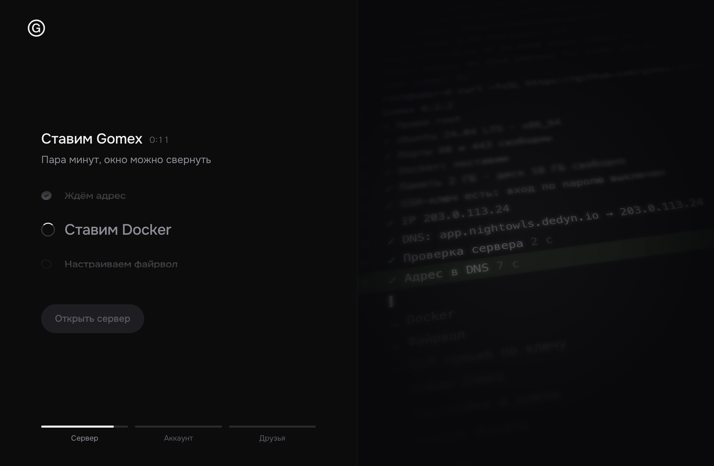
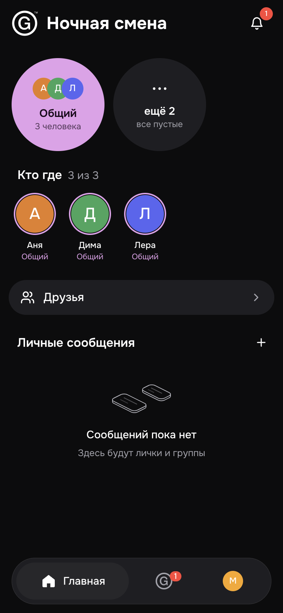
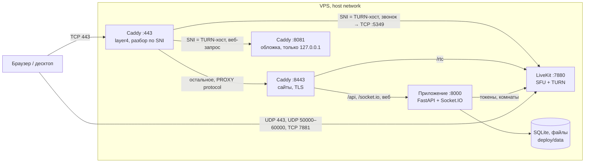

<h1 align="center">Atrium</h1>

<p align="center"><b>Приватный чат и звонки для своих, на своём сервере.</b><br>Голосовые комнаты, показ экрана, разговор по кнопке. Один недорогой VPS, одна команда, около 120 МБ памяти.</p>

<p align="center"><a href="LICENSE"></a> <a href="https://github.com/gomex-inc/gomex/releases/latest"></a></p>

<p align="center"><a href="README.md">English</a> · <b>Русский</b> · <a href="https://github.com/gomex-inc/gomex/releases/tag/desktop">Скачать приложение</a> · <a href="docs/install.ru.md">Установка</a></p>

<p align="center"></p>

Atrium — закрытый Discord для небольшой компании: текстовые и голосовые каналы, личка и группы, видео,
демонстрация экрана, файлы, реакции, упоминания. Один сервер — одна компания, вход только по приглашению.
Звонки держатся и в капризных сетях: если прямое соединение не проходит, LiveKit переключается на TURN через
порт 443 (TLS поверх TCP или UDP). Весь стек — около 120 МБ памяти: одно приложение на Python
с SQLite, LiveKit и Caddy.

## Быстрый старт

Одна команда на чистом VPS с Ubuntu или Debian (доступ root, хватит 1 ГБ памяти):

```bash
curl -fsSL https://github.com/gomex-inc/gomex/releases/latest/download/install.sh | sh
```

Мастер спросит домен, всё настроит и покажет ссылку, по которой создаётся администратор. Друзья заходят по личным
ссылкам-приглашениям.

Нет терминала или своего домена? Подойдёт [приложение для компьютера](docs/install.ru.md#свой-сервер-из-приложения): ему нужны только
IP сервера и пароль root.

## Возможности

- Текстовые каналы, личка и группы; ответы, упоминания, реакции, файлы перетаскиванием.
- Голосовые комнаты, камера и показ экрана. В комнате видно, кто в ней; зайти можно одним нажатием.
- Разговор по кнопке: любая клавиша или кнопка мыши, в том числе при свёрнутом окне.
- Шумоподавление в три уровня: выключено, встроенное в браузер и сильное (RNNoise, небольшая нейросеть, работает
  в клиенте).
- Если UDP закрыт, звонки переключаются на TURN через порт 443; режим «Антилаг» пускает звонок через сервер, когда
  связь слабая.
- Вход только по приглашению, у каждого своя ссылка; пришедший сразу в друзьях у позвавшего.
- Ночные копии с хранением 14 дней, восстановление одной командой.
- Приложения для Mac и Windows с иконкой в трее и подписанными автообновлениями; на телефоне работает веб-версия,
  её можно добавить на домашний экран.
- Интерфейс на русском и английском.

## Скриншоты

<p align="center">
  <br>
  <sub>Текстовые каналы: ответы, упоминания, реакции, файлы</sub>
</p>

<table>
  <tr>
    <td width="50%"><br><sub>Приложение для компьютера: «Свой сервер»</sub></td>
    <td width="50%"><br><sub>Установка по шагам</sub></td>
  </tr>
</table>

<p align="center">
  <br>
  <sub>Раскладка для телефона в браузере</sub>
</p>

## Устройство



- `DOMAIN` — обложка, `app.DOMAIN` — приложение, `<turn>.DOMAIN` — ретранслятор звонков
  с нейтральным именем (`media`, `cdn`, `static`…), которое установщик выбирает случайно.
- Ограничения, которые держим: SQLite, один процесс Python, никаких новых сервисов. Файлы — на диске.

| Путь | Что там |
|---|---|
| [`server/`](server) | Бэкенд. `app.py` собирает приложение, код в пакете `gomex/`: модуль на домен (`users`, `channels`, `dms`, `uploads`, `realtime`), настройки в `config.py`, схема в `db.py` |
| [`web/`](web) | Клиент: React 19, Vite, HeroUI v3, Tailwind 4, LiveKit. `src/` разложен по доменам: `account`, `chat`, `voice`, `people`, `shell`, `ui`, `store` |
| [`desktop/`](desktop) | Electron-оболочка: живёт в трее, чтобы звонки доходили при закрытом окне, глобальный push-to-talk, подписанные обновления |
| [`deploy/`](deploy) | Compose, Caddyfile, установщик, скрипты релиза и бэкапа |
| [`.github/workflows/images.yml`](.github/workflows/images.yml) | Сборка образов `gomex-app` и `gomex-caddy` (amd64 и arm64) на тег `v*` |

## Безопасность

- **Вход только по приглашению.** Код из `INVITE_CODE` годится один раз, для первого аккаунта на пустом
  сервере. Дальше у каждого своя ссылка-приглашение на ограниченное число регистраций.
- **Секреты генерируются на сервере** и лежат в `deploy/.env` с правами 600. В репозитории их нет.
  Продакшн-образ отказывается стартовать с dev-значениями `APP_SECRET`, `LIVEKIT_API_SECRET`, `INVITE_CODE`.
- **Контейнер приложения** работает от uid 10001, файловая система только для чтения (кроме `/data` и `/tmp`),
  без Linux-capabilities, с лимитом памяти 1 ГБ.
- **Сервер:** ufw пропускает только нужные порты (см. [Сеть и порты](docs/operations.ru.md#сеть-и-порты)), SSH ограничен по частоте.
  Вход по паролю установщик выключает, только если в `authorized_keys` уже есть ключ, чтобы не запереть владельца.
- **Цепочка поставки:** установщик сверяет SHA-256 релизного архива и бинарника gum, а образы тянет по digest.
  Обновления десктопа подписаны Ed25519 и приходят из GitHub Releases проекта, какой бы сервер ни был выбран.

Уязвимость сообщайте сопровождающему лично, не в публичных обсуждениях.

## Документация

- [Установка](docs/install.ru.md): из приложения или командой, обновление, восстановление, удаление, параметры установщика.
- [Эксплуатация](docs/operations.ru.md): первый запуск и приглашения, настройки, порты, обслуживание и копии.
- [Разработка](docs/development.ru.md): локальный запуск, проверки, релизы.
- [Архитектура клиентов](docs/adr/001-client-architecture.ru.md) и [дизайн](DESIGN.ru.md): пакеты, Atrium Flow, почему так.

## Сопровождение

[@gomex-inc](https://github.com/gomex-inc).

## Участие

Внешние pull request'ы пока не принимаются; когда начнём, понадобится соглашение контрибьютора (CLA), чтобы права
на весь код оставались у сопровождающего. Вопросы — сопровождающему напрямую.

Правила для своих:

- Не добавлять сервисов: SQLite, один процесс Python, LiveKit, Caddy. Новая функция строится на том, что есть.
- Комментарии в коде — короткие, на английском, объясняют «почему». Тексты интерфейса — короткие, на русском и английском
  (у десктопа — `desktop/i18n.js`), без объяснений.
- Образец поведения — [Fluxer](https://github.com/fluxerapp/fluxer): смотрим, что сделано, но их код (AGPL)
  не копируем и не пересказываем.
- Перед коммитом — `npm run build` в `web/` и `deploy/release.sh lint`.

## Лицензия

[GNU AGPL-3.0](LICENSE), только эта версия (`AGPL-3.0-only`). Atrium можно ставить, менять и распространять, в том
числе за деньги. Если изменённый Atrium доступен людям по сети, его исходники нужно открыть им на тех же условиях.
