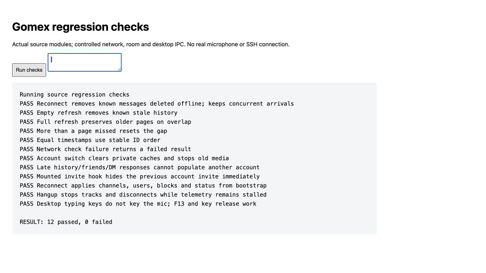

# Исправления по ревью от 20 октября 2026

Исправлены 15 пунктов исходного ревью коммита `c67d212`. Материалы без префикса `fixed-` и скрипты `reproduce_*` сохраняют исходные результаты до исправлений. Актуальные регрессионные проверки находятся в `server/tests`, `desktop/tests` и `web/tests`.

| Пункт | Изменение | Проверка |
|---|---|---|
| R01 | Локальные треки останавливаются и комната отключается независимо от статистики; HTTP статистики ограничен 5 секундами. | Браузер: зависшая статистика не задерживает hangup. |
| R02 | Desktop PTT использует общую проверку редактируемого поля при фокусе окна; отпускание обрабатывается всегда. | Браузер: KeyV в textarea, F13, отпускание. |
| R03 | Вход проверяет исходные хеш и версию; миграция хеша условная; JWT и media-cookie привязаны к проверенной версии. Bootstrap не обновляет старую сессию до новой версии cookie. | pytest: гонка login/reset для актуального и legacy-хеша, гонка bootstrap/revoke. |
| R04 | Recovery обновляет запись только при совпадении исходных recovery_hash и token_version. | pytest: ровно один успешный параллельный запрос. |
| R05 | Проверка блока общая для выдачи voice-token, Socket.IO join и Caddy; block завершает существующий личный звонок. | pytest: HTTP, ранее выданный JWT и удаление участника. |
| R06 | Выданные комнаты сохраняются в SQLite; отзыв сессии вызывает RemoveParticipant и session:ended. Caddy проверяет текущую версию сессии и доступ к комнате при signalling-запросах. Версия хранится в metadata, сохраняемой LiveKit при refresh; JWT действует 10 минут. | pytest: отзыв без presence, сохранённые metadata обновлённого JWT; реальный Caddy + ASGI, медиасервер заменён записывающей моделью. |
| R07 | Смена личности сбрасывает store и медиа, увеличивает номер сессии. История, friends/DM, приглашения и поздняя пагинация проверяют номер сессии. Кэш и состояние приглашения принадлежат своей сессии. Отзыв авторизации очищает сессию и перезагружает страницу. | Браузер: очистка личных данных, поздние ответы, смонтированный hook приглашения. |
| R08 | Обязательные команды установки явно возвращают ошибку; run больше не получает ложный успех после сбоя копирования, распаковки или настройки. | pytest: сбои cp, tar, install; firewall не включается после неоткрывшегося порта; ShellCheck. |
| R09 | Изменение пароля и recovery удаляют старые reset links в одной транзакции с обновлением пароля. | pytest: старый link отклоняется при check и reset. |
| R10 | История и inbox используют составной курсор createdAt/id; клиент передаёт оба значения. Порядок сообщений на клиенте учитывает id при равном времени. | pytest: channel, DM, inbox с совпавшими миллисекундами; браузер: порядок id. |
| R11 | Refresh убирает известные удалённые сообщения, сохраняет новые socket-сообщения, сбрасывает разрыв при пропуске больше страницы. | Браузер: удаление, пустой ответ, перекрытие страниц, большой пропуск. |
| R12 | Catch-up применяет весь bootstrap и обновляет friends/DM; исчезнувшая голосовая комната завершает звонок. | Браузер: каналы, имена, блоки и статус после reconnect. |
| R13 | Получение check-token входит в try/catch и ограничено 15 секундами. | Браузер: сетевой отказ возвращает fail. |
| R14 | Backup удерживает общий с приложением flock до копирования медиа. Удаления файлов откладываются без блокировки event loop и повторяются housekeeping. Копия публикуется только после успешного rsync, предыдущая завершённая копия сохраняется при сбое. | pytest: реальный SQLite snapshot и файловый lock, удаление после снимка, отказ rsync, повтор orphan cleanup. |
| R15 | SSH probe и install обрабатывают транспортные ошибки/закрытие; renderer сбрасывает busy в finally и показывает повтор установки. | Node: 7 сценариев, включая close/end до ready и error/close/end во время probe. |

Результаты окончательного прогона:

- `server/.venv/bin/python -m pytest -q server/tests`: **37 passed**.
- `node --test desktop/tests/*.test.cjs`: **7 passed**; синтаксис изменённых JS проверен.
- Браузерный стенд `bash web/tests/run-regressions.sh`: **12 passed, 0 failed**.
- `npm run build` в web: успешно; осталось предупреждение Vite о chunk больше 500 kB.
- `npm run check:i18n` в desktop: **247 keys**.
- `deploy/release.sh lint` с ShellCheck 0.10.0: **All deploy scripts clean**.
- App-фрагмент Caddyfile проходит adapt/validate. `server/.venv/bin/python server/tests/check_rtc_proxy.py`: действующий JWT получает 200, отозванный/некорректный — 401 и не достигает медиа upstream.
- `git diff --check`: успешно.

Для отзыва голосового доступа нужно выпускать сервер и обновлённый Caddyfile вместе. Старый маршрут Caddy без forward_auth не выполняет новую проверку сессии. В production LiveKit signalling должен оставаться доступным только через этот маршрут; development URL напрямую на localhost:7880 используется для локальной разработки.

Проверки используют временные данные. Реальные LiveKit media/TURN, нативный keyboard hook Electron, полные Mac/Windows-сборки, установка и restore на VPS не запускались. Удаление участников в тестах заменено моделью RoomService; реальные звонки и поведение при недоступности RoomService требуют отдельного интеграционного прогона. Это ограничение проверки, а не подтверждение работы этих интеграций.

Основание для размещения версии сессии в metadata: [LiveKit tokens and grants](https://docs.livekit.io/frontends/reference/tokens-grants/). Контракт проверки signalling-маршрута: [Caddy forward_auth](https://caddyserver.com/docs/caddyfile/directives/forward_auth).

